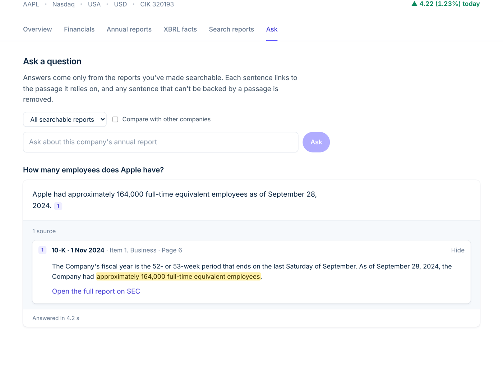
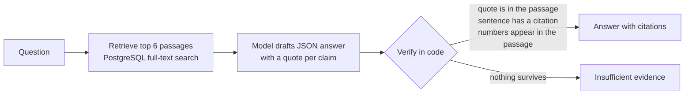
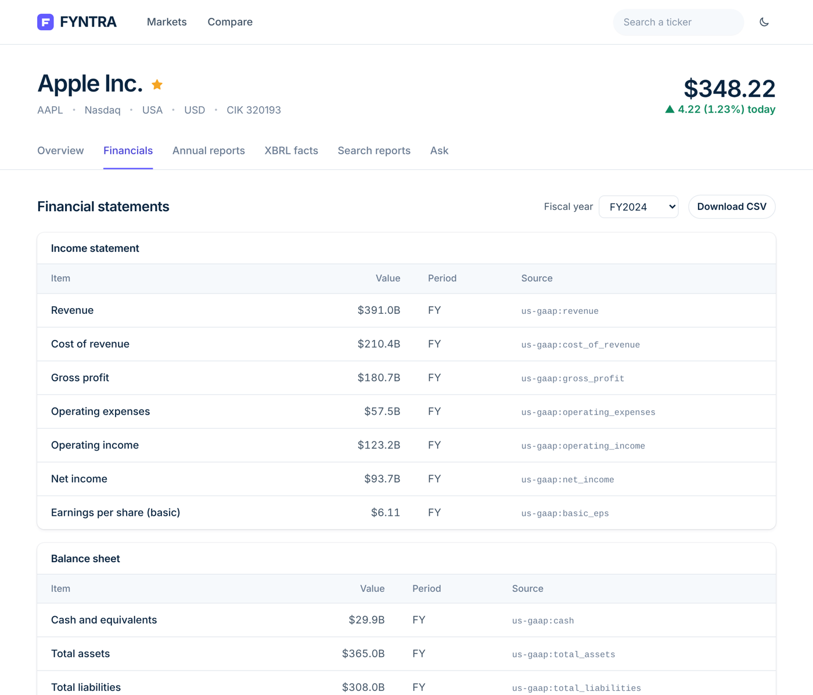
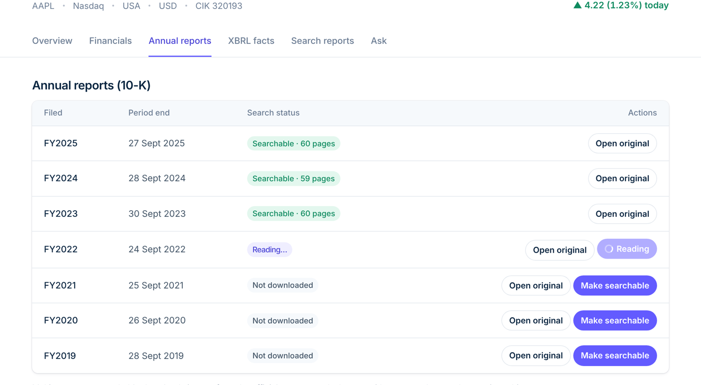
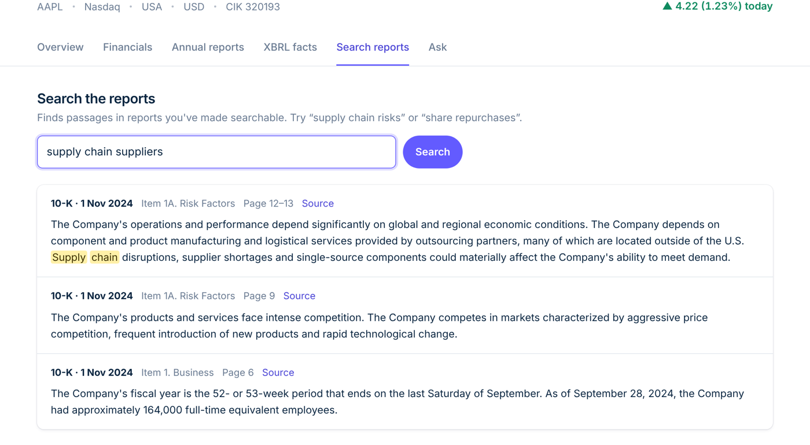
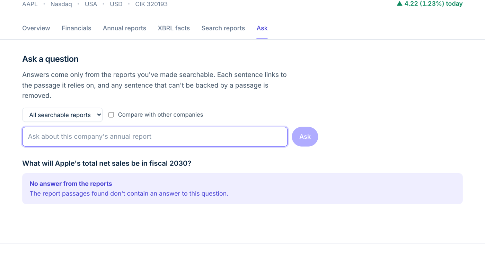
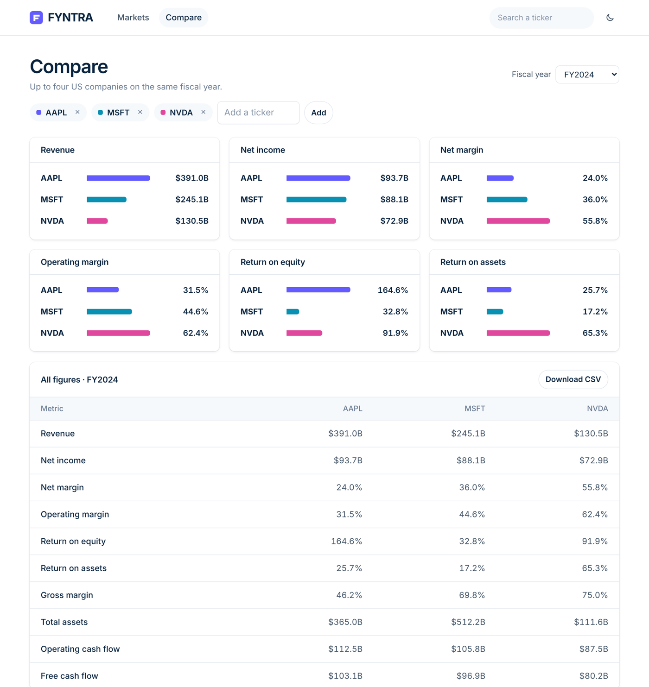
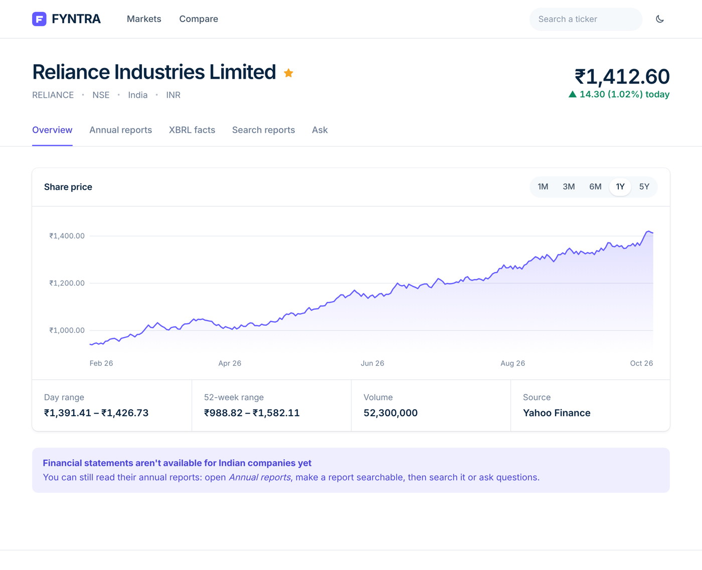
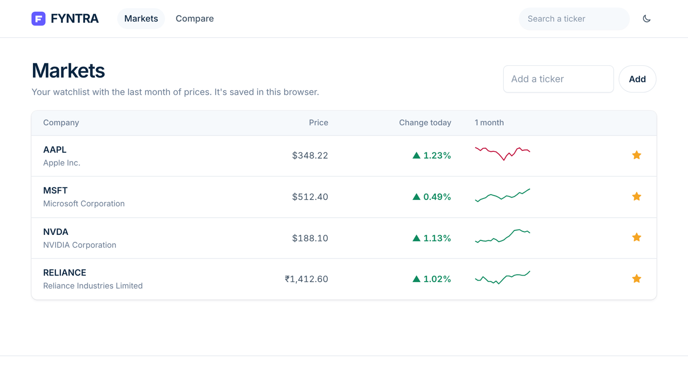
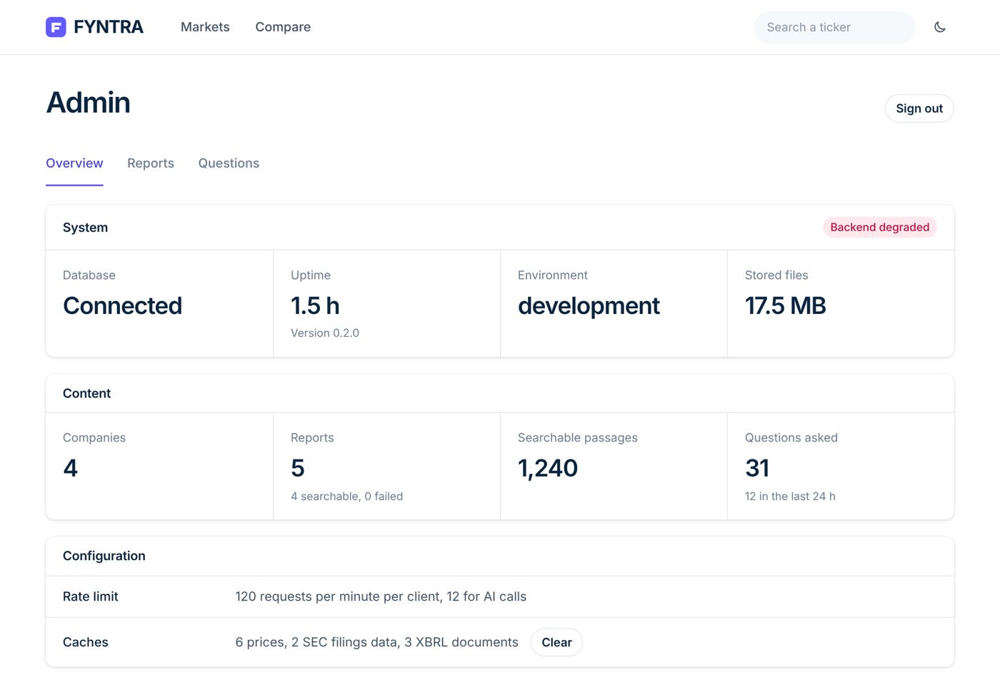

# FYNTRA

**Financial Year Narratives, Tables, Ratios & Answers**

*Annual Report Buddy: ask anything about a company, with proof.*

FYNTRA downloads the official annual reports of public companies, reads them page by page and answers plain-language
questions using **only** what the report says. Every sentence of an answer is checked in code against a quoted passage
from the filing, or it is removed. When the report does not contain the answer, FYNTRA says so instead of guessing.

> Research and education tool. FYNTRA does not trade, connect to brokers, predict prices or give investment advice.



## What it does

| | |
|---|---|
| **Cited answers** | A language model drafts the answer with a quotation per claim. Code then verifies every quote, every sentence and every number against the source passage. Unsupported sentences are removed; if nothing remains, the answer is a refusal. |
| **Financial statements and ratios** | Read from SEC XBRL data, never from the model. Each ratio shows the formula it was calculated with. |
| **XBRL fact explorer** | Every number a company tagged in its filing, with period and breakdown, for US 10-K filings and Indian (NSE) results filings. CSV export. |
| **US and Indian companies** | SEC EDGAR for US companies, NSE India for Indian ones. |
| **Cross-company questions** | One question to two or three companies; each answer is verified and logged separately. |
| **Markets and comparison** | Watchlist with prices (Yahoo, Stooq fallback) and a side-by-side comparison of up to four companies. |
| **Admin page** | Backend health, report status (re-read or delete), and a log of every question with its outcome. |

## How an answer is built



The model never supplies a number on its own: figures come from XBRL data or from verified quotations.

## Screenshots

| | |
|---|---|
|  |  |
|  |  |
|  |  |
|  |  |

*Screenshots use sample data to show the layout.*

## Repository layout

```
backend/    FastAPI + PostgreSQL API: providers (SEC, NSE), document pipeline, XBRL, cited Q&A, LLM gateway, tests, eval kit
frontend/   React + TypeScript + Vite web app (the API key stays on the dev server, never in the browser)
docs/       Evaluation method and screenshots
```

## Quick start (local)

Requirements: **Python 3.12**, **Node 18+**, **Docker** (for PostgreSQL), a model API key from an OpenAI-compatible provider.

**1. Backend**

```bash
cd backend
python3 -m venv venv && source venv/bin/activate      # Windows: venv\Scripts\activate
pip install -r requirements.txt
cp .env.example .env
```

Edit `backend/.env`: paste your `LLM_API_KEY`, set `LLM_MODEL` to a model your plan includes, and put a real email in
`SEC_USER_AGENT` (the SEC blocks anonymous clients). Then:

```bash
docker compose up -d db          # PostgreSQL
alembic upgrade head             # create the tables
python scripts/check_llm.py      # checks the model setting and prints the provider's real error if something is wrong
uvicorn app.main:app --reload    # API on http://127.0.0.1:8000  (docs at /docs)
```

**2. Frontend** (a second terminal)

```bash
cd frontend
npm install
cp .env.example .env             # FYNTRA_API_KEY must equal API_KEY in backend/.env
npm run dev                      # open http://127.0.0.1:5173
```

**3. Use it.** Search a ticker (for example `AAPL`), open **Annual reports**, press **Make searchable** on a report, then use **Ask**.

> Both servers read their `.env` only at start. Restart them after editing it.

## Configuration

The language model is configured in **one place only, `backend/.env`**. The web app never sees a model name or a provider error.

| Variable | Purpose |
|---|---|
| `LLM_BASE_URL` | OpenAI-compatible endpoint (`/chat/completions` is added automatically) |
| `LLM_API_KEY` | Your provider key |
| `LLM_MODEL` | Model used for answers |
| `LLM_FALLBACK_MODEL` | Optional second model, tried only if the first fails |
| `API_KEY` / `FYNTRA_API_KEY` | Shared key between backend and frontend dev server |
| `STORAGE_DIR` | Where original filings are saved (relative paths sit inside `backend/`) |

All settings are listed in [`backend/README.md`](backend/README.md#configuration).

## Tests and evaluation

```bash
cd backend && pytest          # 94 tests; external services are mocked
cd frontend && npx tsc --noEmit && npm run build
```

A separate **31-question accuracy test** runs against real filings of Apple, Microsoft and Tesla. With GPT-6 Luna it scored
30 of 31 (19/19 figures, 5/5 correct refusals, every answer cited). The method and sample questions are in
[`docs/EVALUATION.md`](docs/EVALUATION.md).

## Deployment

A Docker Compose stack with automatic HTTPS (Caddy), the API and PostgreSQL is provided in
[`backend/docker-compose.prod.yml`](backend/docker-compose.prod.yml), with a step-by-step guide in
[`backend/deploy/VPS_SETUP.md`](backend/deploy/VPS_SETUP.md). It has not yet been validated on a live server.

## Known limitations

- Retrieval is keyword-based, so a question using none of the report's words can miss the right passage.
- Scanned PDFs are detected but not read (no OCR yet).
- Statements and ratios cover US companies; Indian companies have price, reports and the XBRL fact explorer.
- NSE and the Yahoo/Stooq feeds are unofficial and may change or block server IPs.

## Project

Mini project for the course **Business Analytics**, Symbiosis Artificial Intelligence Institute (SAII), Symbiosis International
(Deemed University), Pune.

Team: Jash Shah, Vivaan Kriplani, Gaargi Chandrawat, Srishti Misra.
Internal mentor: Dr. Bela Joglekar. Industry mentor: Mr. Sanchit Mehrotra.

Licensed under the [MIT License](LICENSE).
